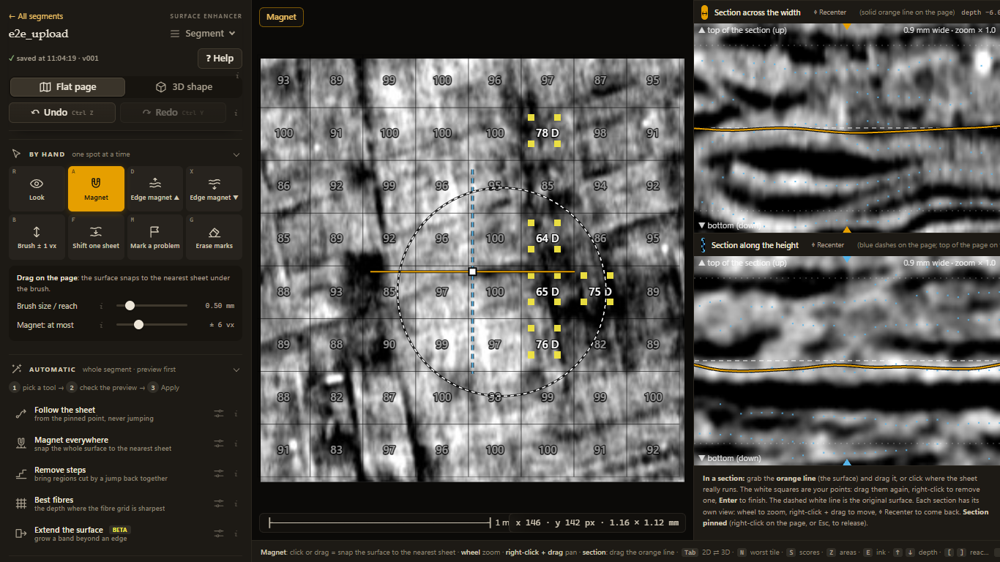
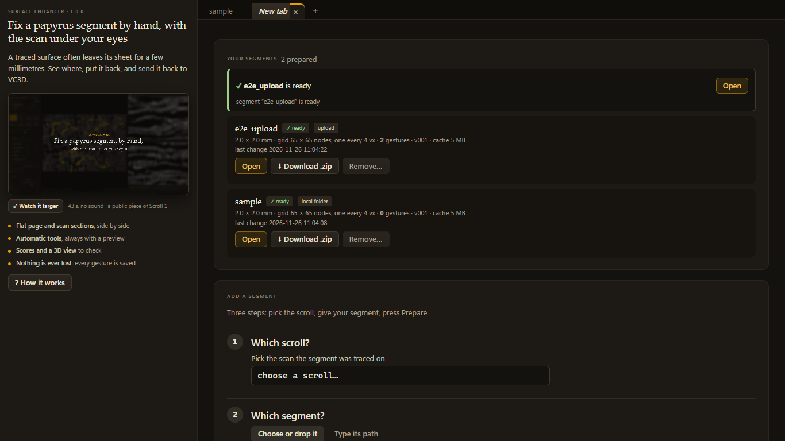
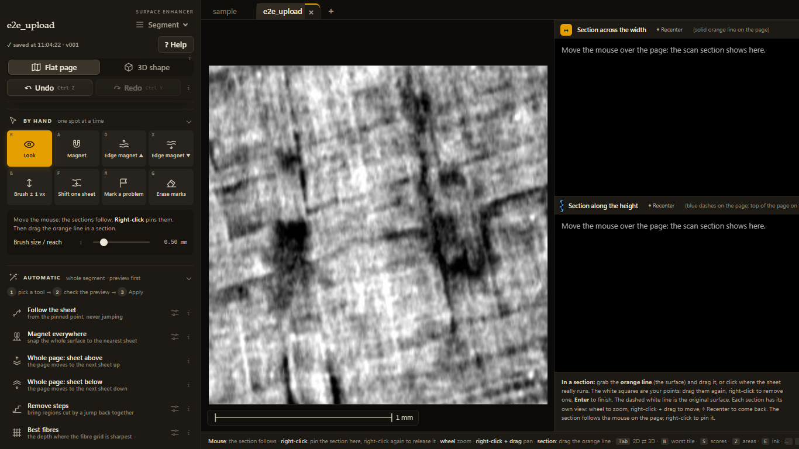

# Surface Enhancer

**Fix a papyrus segment by hand, with the scan under your eyes.**

A segment traced in the CT scan of a Herculaneum scroll often leaves its sheet for a few millimetres, slips onto the
next sheet, or sits between two. That is where the ink reading goes blank. Surface Enhancer shows you where, lets
you put the surface back, and gives you a **new** segment that
[Volume Cartographer / VC3D](https://github.com/ScrollPrize/villa) reads.



> **Version 1.** The core — sections, magnet, undo, export to VC3D — has been used on real pages. Several tools are
> recent and will need improving: *Find sheet jumps*, *Extend the surface*, *Follow the sheet*, the tabs and the
> import. If something breaks or could be better, open an issue or, better, a pull request:
> **every PR that improves the tool is welcome** (see [Contributing](#contributing)).

## What you can do with it

- **See the scan and the surface together.** The flat page on the left; on the right two sections of the scan through
  the point under the mouse, each with its own zoom, and a low-resolution view of the whole scroll with your segment
  drawn in it.
- **Fix by hand, in seconds.** Drag the surface onto the sheet in a section, or draw it through a few points. Brush
  with the **magnet** (it snaps to the nearest sheet, with a neighbourhood vote so it does not grab the wrong one),
  sit on the face that carries the ink with the **edge magnet**, send a painted region to the sheet above or below.
- **Let it work on the whole segment**, always with a preview before anything is written: *Follow the sheet* from a
  point you trust, *Magnet everywhere*, *Remove steps*, *Best fibres*, *Extend the surface* (beta).
- **Find where it went wrong.** A score per 0.3 mm tile, "go to the worst tile", a fibre score map, and **Find sheet
  jumps**: a map of where the surface sits on another sheet than the point you trust, with the number of sheets.
- **Never lose anything.** The original is never modified. Every gesture is saved at once, undo has no limit (even
  after a restart), and the journal of gestures — tool, parameters, surface before and after — is kept with the
  segment and can be replayed.
- **Go back to VC3D.** Export a new tifxyz segment, in the working grid or in the node layout VC3D had, straight into
  a volume package if you want.
- **Work on several segments** at once, one tab each.
- **Learn it as you go**: every control has an ⓘ with what it does, how to use it and a small animation.

Everything is local: a small Python server on `127.0.0.1` and a web page. No account, nothing uploaded, no GPU
needed. After one preload of the segment, everything is instant.

| Start: your segments, add a segment | Several segments, one tab each |
|---|---|
|  |  |

More screenshots: [3D view](docs/images/editor_3d.png), [export](docs/images/editor_export.png),
[built-in help](docs/images/editor_help.png), [a VC3D package opened](docs/images/home_vc3d_package.png).

## Install

Python 3.10 or newer (developed on 3.12).

```
git clone https://github.com/vincentl065/surface-enhancer
cd surface-enhancer
python -m venv .venv
.venv/bin/pip install .            # Windows: .venv\Scripts\pip install .
```

This gives the command `surface-enhancer` (the same as `python -m surface_enhancer`). `requirements.txt` lists the
exact versions the tool was developed and tested with, if you want them (`pip install -r requirements.txt`).
There is nothing to compile. PyTorch is **not** required (only the optional `flatten` command uses it).

Developed and tested on Windows. Nothing in it is Windows-specific, but Linux and macOS have not been tried yet.

## Five-minute start

The repository ships a tiny sample (a 2 mm piece of Scroll 1, 2.7 MB — see [sample/README.md](sample/README.md)),
so you can try everything without downloading a scan. From the folder of the repository:

```
surface-enhancer sample           # preloads the sample, a few seconds
surface-enhancer open sample      # starts the server and opens the editor in your browser
```

Then:

1. **right-click** on the page to pin the sections there (right-click again to release them);
2. in a section, grab the **orange line** (the surface) and drag it onto the bright band (the sheet);
3. or press **A** (magnet) and drag over the page; press **S** to see the score map;
4. **Automatic → Magnet everywhere**: look at the preview, then **Apply** (one Ctrl+Z undoes it);
5. press **J** for the sheet-jump map, **Tab** for the 3D view;
6. **Segment → Export…** gives a zip (tifxyz segment + offset field + journal of gestures).

## Your own segment

One command — it prepares the segment if needed, starts the server if needed, and opens the editor:

```
surface-enhancer open <segment folder> <scan volume>
```

- the **segment** is a tifxyz folder (`x.tif`, `y.tif`, `z.tif`, `meta.json`), or a `.zip` of it. Traced in VC3D, it
  is one folder of `<your scroll>.volpkg/paths/`;
- the **scan volume** is the one it was traced on: a local OME-Zarr folder, an `https://` URL or an `s3://` URL. It is
  read anonymously, read-only; only the 128³ blocks your surface touches are downloaded, and kept in a cache.

Or do it in the page: the **+** of the tab strip opens a *New tab* with your segments and **Add a segment** — pick
the scan, choose or drop your segment folder, press Prepare. When the folder names its scan (VC3D writes it in
`meta.json`), the scan is picked for you.

The preload reads the scan once along the normal of the surface, 40 voxels above and below: seconds for a few
millimetres, minutes to an hour for a page of several centimetres read over the network. It needs about 81 bytes of
disk per pixel of the flat page (1.8 GB for a 5 000 × 4 500 px page), announced before it starts. Grids coarser than
8 voxels between nodes (VC3D traces are often at 20) are resampled to 4 voxels for the retouch; the export can give
back the original node layout.

**With an AI assistant.** An assistant that has a terminal can open a segment for you with that same command:
[docs/FOR_AI_ASSISTANTS.md](docs/FOR_AI_ASSISTANTS.md) tells it how (`--json` gives it one line to read).

## With VC3D

In a *New tab*, open a `.volpkg` folder, a VC3D project file or a plain folder of segments: its volumes and segments
are listed, one click prepares a segment, and **Export → Write into a VC3D volume package** writes the retouch as a
**new** segment next to the original. Step by step, with what was verified against the VC3D source and what was not:
[docs/USING_WITH_VC3D.md](docs/USING_WITH_VC3D.md).

This is an integration at the level of the data. There is **no plug-in inside the VC3D application**.

## Commands

```
surface-enhancer open | stop | serve | sample | prepare | list | volpkg | export | replay
                  compare | render | ink-layer | densify | flatten        (--help on each)
```

| | |
|---|---|
| `open SEGMENT [VOLUME]` | prepare if needed, start the server if needed, open the editor (`--json` for scripts) |
| `stop` | stop the server that `open` started |
| `export NAME [--to-volpkg [PATH]] [--zip FILE]` | new tifxyz segment (never over an existing one), or a zip |
| `replay NAME` | replays the journal from the original surface and checks it gives the same surface |
| `compare NAME` | scan before / after images and the fibre-grid score |
| `render NAME`, `ink-layer NAME "Label=file.tif"` | the hook for your own ink model: [docs/INK.md](docs/INK.md) |
| `densify SRC DST` | resample a coarse grid to a fine one |
| `flatten SRC DST` | lay a retouched surface flat again (optional, needs PyTorch) |

Where data and cache live, the port, proxies: [docs/CONFIGURATION.md](docs/CONFIGURATION.md).
Files written on disk: [docs/DATA_LAYOUT.md](docs/DATA_LAYOUT.md). HTTP API: [docs/HTTP_API.md](docs/HTTP_API.md).

## Limits

- A retouch is limited to ± 32 voxels around the original surface (the preload covers ± 40). To go further: export,
  then prepare the export as a new segment.
- The tools follow the sheets *detected* in the scan (peaks of the profile along the normal). In tightly packed or
  damaged areas they can pick the neighbouring sheet: look at the preview, and at the sections.
- *Find sheet jumps* says "not sure" wherever the reference sheet cannot be followed up to there; on a hard page
  that can be more than half of it. It finds a region moved by one sheet in the tests, but it has not been checked
  against many real cases yet.
- The scores help you find places to look at. They are not a proof, and a cleaner surface does not by itself give
  more ink: what pays is putting the surface back on the right sheet, on the face that carries the ink.
- No ink model is included. Ink layers shown in the editor are images you provide, predicted on the original surface.
- Sections are cut along the surface (in the straightened block), not along the x, y, z planes of the scan.
- Only the full-resolution level of the volume is read; 8-bit data is assumed (16-bit is reduced to 8).
- One user at a time. The server has no authentication: keep it on `127.0.0.1`.
- Part of the source (the editing core) still has French identifiers and comments: see [docs/STATUS.md](docs/STATUS.md).

Accessibility: nothing is carried by colour alone. Scores use blank / dots / hatching / cross-hatching plus numbers,
directions use ╱ and ╲ hatching, states carry ✓ ✗ ⚠ and a word. The palette is Okabe–Ito on a dark theme.

## Tests

```
pip install pytest aiohttp
python -m pytest tests
```

29 tests on the bundled sample, about 30 seconds, no network, no GPU: the tifxyz reader / writer, the VC3D round
trip, the editing core (undo and journal replay are exact), the sheet-jump map, the detection of the scan, the HTTP
API, the `open` command, and one end-to-end journey in a headless Chrome (skipped when no Chrome is found).

## Contributing

Pull requests are welcome, small or large. Good places to start:

- **what does not work for you**: another operating system, a scan or a segment the tool refuses, a slow step;
- **the recent tools**: *Find sheet jumps* (too much "not sure"), *Follow the sheet*, *Extend the surface*;
- **ideas** ([docs/STATUS.md](docs/STATUS.md)): re-reading the scan around a retouched zone to go beyond ± 32 voxels,
  following a sheet from a drawn line instead of one point, fibre or surface predictions as an extra signal for the
  magnet, ink re-reading from the editor.

Before sending: `python -m pytest tests`. The editing core keeps French identifiers for now
([docs/MERGE.md](docs/MERGE.md) says where each piece comes from); write new code and everything a user reads in
English.

## Licence and data

Code: MIT, © Vincentl065 — see [LICENSE](LICENSE).

The data shipped in this repository comes from the Vesuvius Challenge scans (EduceLab-Scrolls) and is **not** covered
by the MIT licence: the sample in `sample/` ([sample/README.md](sample/README.md)) and the low-resolution overviews
of the public scans in `surface_enhancer/web/scrolls/` (one voxel for 32 to 257 of the scan). They are
redistributed as small excerpts, under the terms of the Vesuvius Challenge data (<https://scrollprize.org/data>). If
you use the scans, cite the Vesuvius Challenge and EduceLab as they ask.
